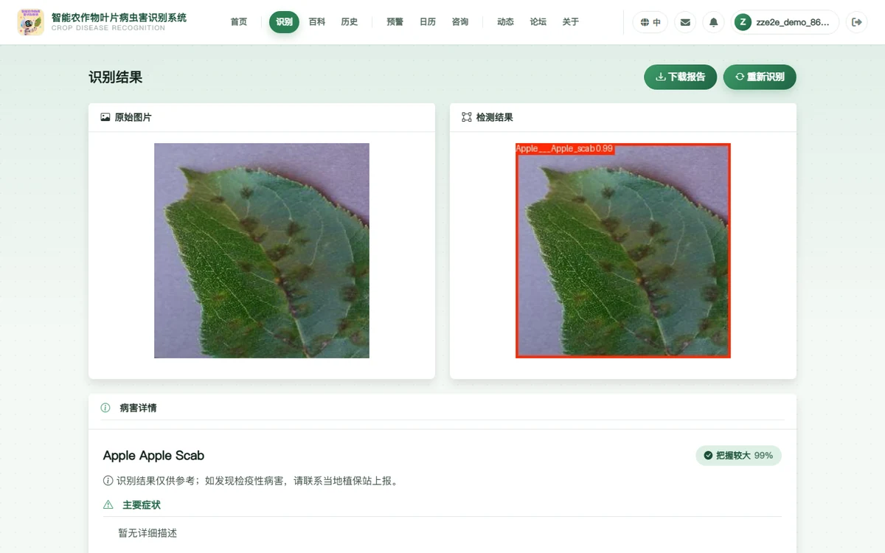
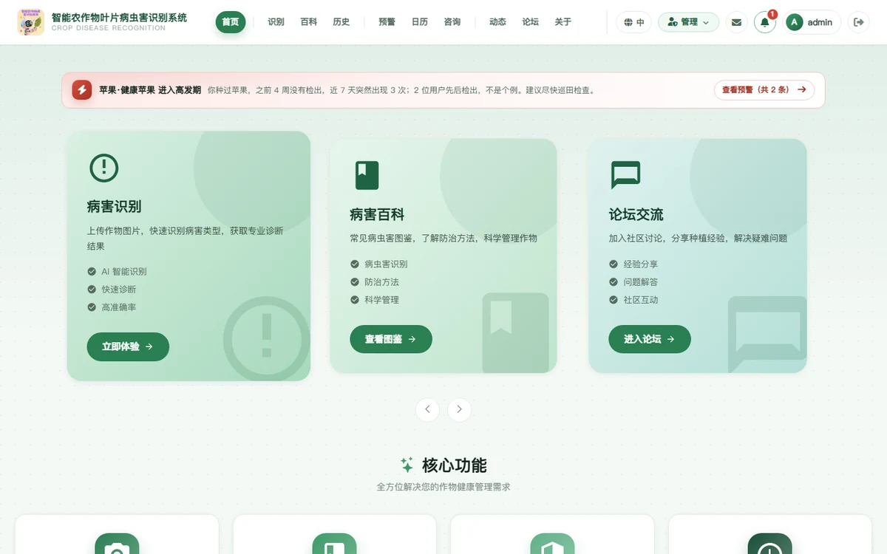
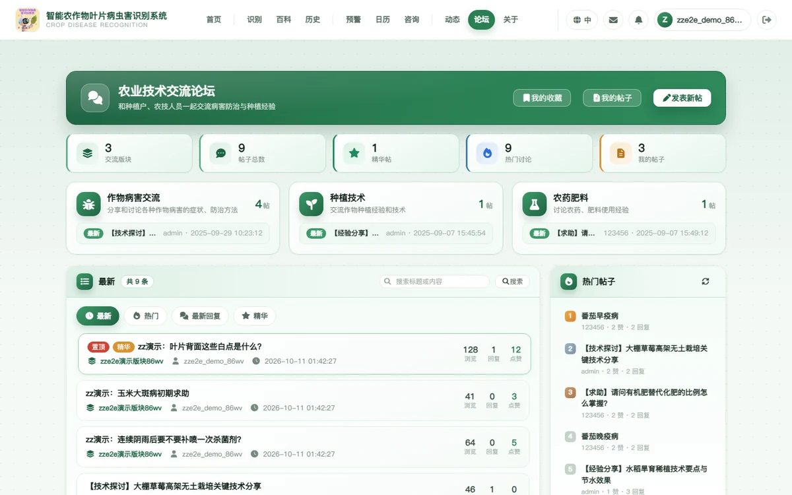
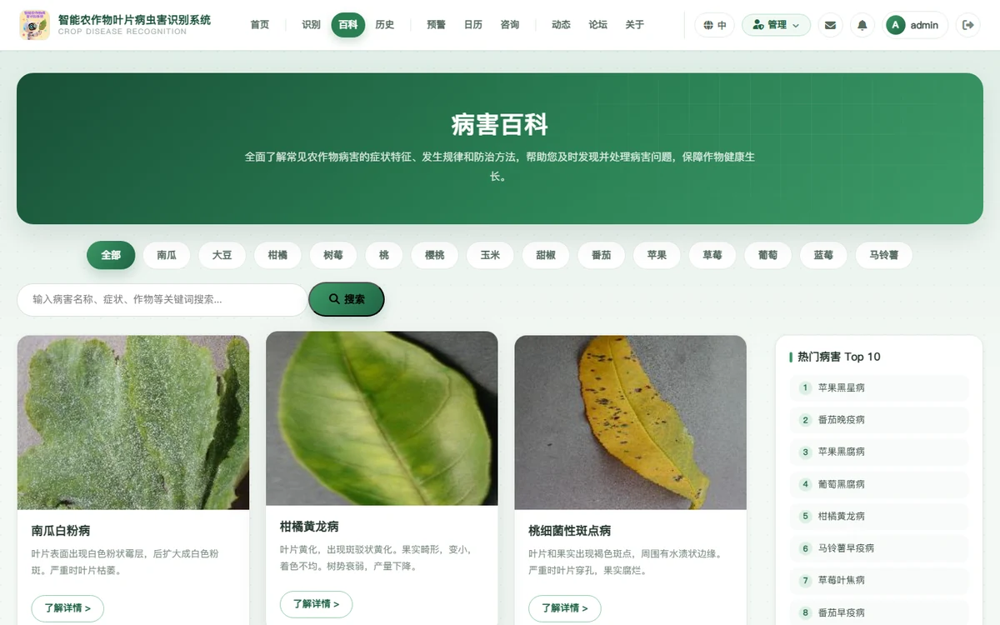
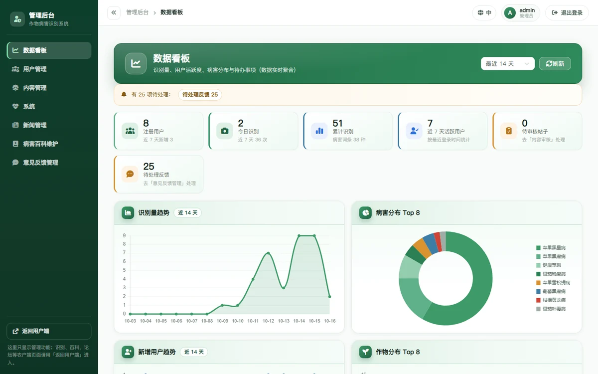
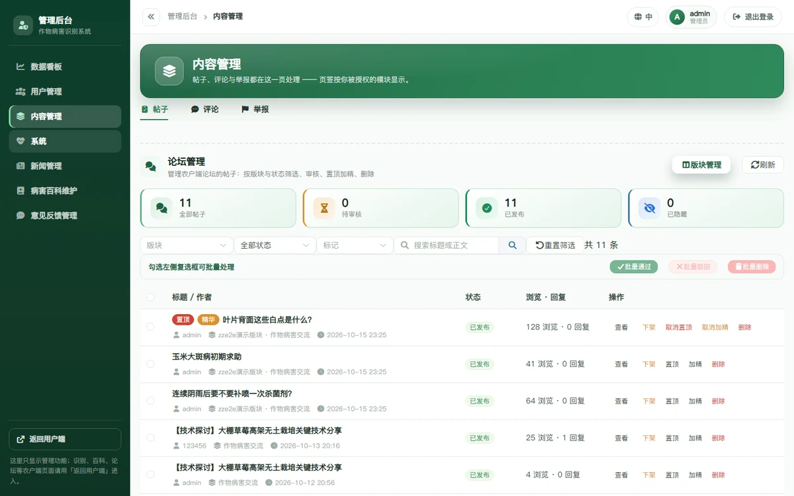
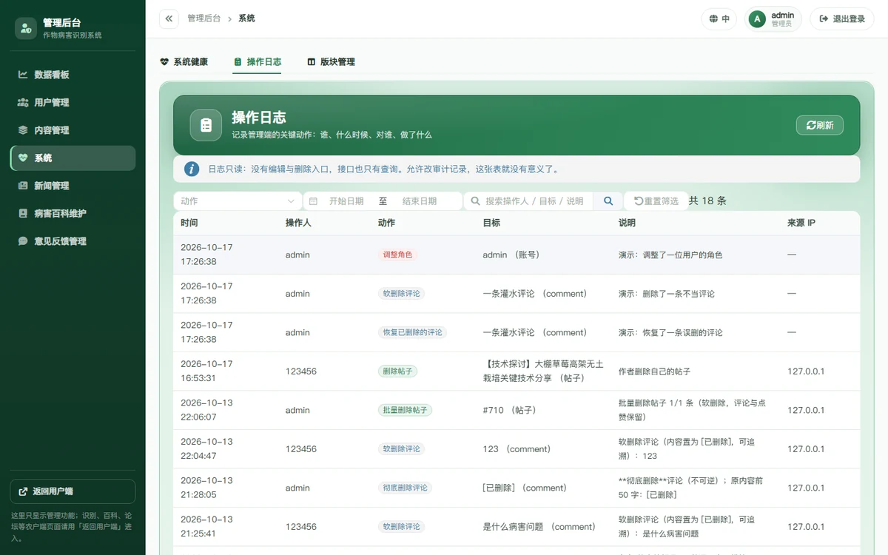

# 智能农作物叶片病虫害识别系统

上传一张叶片照片，得到**病害名称、置信度与防治建议**；配套病害百科、识别历史、病害预警、
种植日历、专家咨询与论坛交流，并带一套完整的**管理后台**（用户与权限、内容审核、论坛与评论、
新闻、病害百科、意见反馈、操作日志）。

> 面向农户的桌面端 + 移动端两个独立前端，共用一个 Django REST 后端；
> 识别用 YOLOv8 目标检测，**识别结果仅供参考**。



---

## 功能全景

### 农户端（桌面端 Vue 3 / 移动端 Vue 3 + Vant）

| 模块 | 能力 |
|---|---|
| **病虫害识别** | 上传/拍照识别，返回病害名、置信度与标注框；一键下载报告 |
| **识别历史** | 记录列表与详情、按病害筛选、清空 |
| **病害百科** | 38 类病害词条（症状、防治方法）、3×2 网格浏览、多语言词条 |
| **病害预警** | 预警列表与订阅 |
| **种植日历** | 农事任务（播种/施肥/用药）增删改与提醒 |
| **专家咨询** | 提问与作答、专家身份展示 |
| **论坛交流** | 版块、发帖（富文本 + 图片）、评论与回复、点赞收藏、**置顶/加精** |
| **其他** | 站内信与通知、意见反馈、个人资料、举报、中英文切换 |

### 管理后台（9 个页面，权限细分到模块）

| 页面 | 主要能力 | 谁能进 |
|---|---|---|
| 数据看板 | 用户/内容/识别量聚合 | 内容能力 |
| 用户管理 | 停用·恢复、角色与内容模块授权、开通编辑员、签发重置链接、注销冷静期账号查看 | `USER_ADMIN` |
| 内容审核 | 待审帖子队列、举报处置、敏感词库 | `review` 模块 |
| **论坛管理** | 跨帖子管理：状态/版块/关键字筛选、通过·驳回、置顶·加精、批量操作 | `review` 或 `forum` |
| **评论管理** | 跨帖子评论管理、软删除（**可恢复**）、彻底删除 | 同上（彻底删除仅全权管理员）|
| **操作日志** | **21 类**管理动作的审计记录：按动作/时间/关键字筛选，只读 | **仅全权管理员** |
| **系统健康** | 环境自检（依赖/迁移/模型文件/目录可写/注销到期/**备份新鲜度**/生产开关）+ 数据量概览 + 运行时信息 + **14 天趋势**（缺快照的那天画灰格） | **仅全权管理员** |
| 新闻管理 | 行业动态增删改、上下架、图片上传 | `news` 模块 |
| 病害百科维护 | 词条增删改、批量导入、农事任务 | `pests` 模块 |
| 意见反馈管理 | 查看/回复/流转状态、批量操作 | `feedback` 模块 |
| 版块管理 | 版块新建·编辑·启停·排序 | `BROADCAST` |

---

## 界面

<table>
  <tr>
    <td width="50%"><b>识别首页</b><br/></td>
    <td width="50%"><b>论坛交流（含置顶/精华）</b><br/></td>
  </tr>
  <tr>
    <td width="50%"><b>病害百科</b><br/></td>
    <td width="50%"><b>管理后台·数据看板</b><br/></td>
  </tr>
  <tr>
    <td width="50%"><b>论坛管理（后台）</b><br/></td>
    <td width="50%"><b>操作日志（审计）</b><br/></td>
  </tr>
</table>

> 管理端截图里另有一张「评论删除可恢复」留证：`docs/images/admin-comment-restore.webp`。

---

## 技术栈与结构

```
backend/    Django 5.2 + DRF（SQLite，YOLOv8 推理，150 个 Python 文件 / 约 3.4 万行）
frontend/   桌面端 Vue 3 + Element Plus + Vite（:5173，68 个 .vue 文件 / 约 4.2 万行）
mobile/     移动端 Vue 3 + Vant + Vite（:5174，独立应用，与桌面端零代码共享）
docs/       设计与运维文档、README 配图、工具脚本
tools/      开发辅助脚本（注释覆盖审计等）
deploy/     部署相关（gunicorn / systemd / Nginx 示例）
```

识别链路：`图片 → Django 接收 → YOLOv8 推理（backend/api/newmodels/best.pt）→ 标注图 + 病害映射 → 结构化结果`
（结果与上传文件都落库，供历史与报告使用）。

---

## 快速开始

```bash
# ── 后端（需要一个装好依赖的 Python 环境）──────────────────────────────────
cd backend
pip install -r requirements.txt
python manage.py migrate
python manage.py check_env                    # 环境自检：依赖/数据库/迁移/模型文件
python manage.py init_forum_boards            # 初始化论坛版块（首次跑）
python manage.py runserver 127.0.0.1:8000

# ── 桌面端 ────────────────────────────────────────────────────────────────
cd frontend && npm install && npm run dev      # http://127.0.0.1:5173

# ── 移动端（可选，独立应用）───────────────────────────────────────────────
cd mobile && npm install && npm run dev        # http://127.0.0.1:5174
```

> ⚠️ **首次跑之前请先看 [`docs/部署与运维.md`](docs/部署与运维.md)** ——
> 它写清了 `pip install -r requirements.txt` **照原样装不出能跑的环境**这件事，
> 以及生产启动（gunicorn + WhiteNoise）、环境变量、必须挂的几个定时任务。
> 演示数据可用 `add_sample_news` / `add_popular_pests` / `add_detailed_pests` 等管理命令灌入
> （共 **22 个**管理命令，`python manage.py help` 可查）。

> 🔧 编辑帖子页顶部那块「开发信息」面板**默认不显示**；要排查问题时用
> `.env.development` 里的 `VITE_SHOW_DEBUG_PANEL=true`，或控制台
> `localStorage.setItem('dsh_debug_panel','1')` 后刷新（见 `frontend/src/utils/debugFlags.js`）。

---

## 测试与验证

```bash
# 后端：667 条测试（权限矩阵、限流、注销冷静期、备份恢复、审计日志……）
cd backend && python manage.py test api.tests

# 桌面端：104 条单元测试 + 类型检查 + 4 个一致性检查脚本
cd frontend && npm run test:unit && npm run type-check && npm run check

# 端到端（真实后端 + 真实浏览器）：5 个 Playwright spec + 41 个按批留证的验证脚本
cd frontend && npm run e2e                     # Playwright 用例（5 个 spec）
cd frontend && node scripts/verify-forum-module.mjs   # 按批留证的验证脚本（41 个）
```

`npm run check` 串了 **4 个检查脚本**（其中一致性检查内部再细分 A/B/C 三小项），都是**踩过坑之后加的**：
英文语言包不能残留中文、中英术语必须一致、模板用到的 Element Plus 组件必须已注册、
**每条路由都要有 `docTitle` 文案**（它是按路由名动态查的，缺了只在控制台留一句警告）。

仓库级自检（提交前跑）：

```bash
python docs/tools/check_line_endings.py        # 行尾一律 LF
python docs/tools/strip_bom.py --check backend/api frontend/src docs
python docs/tools/check_md_links.py            # .md 里的相对链接/图片都存在且**已入库**
python docs/tools/check_i18n_coverage.py       # 模板里还有多少裸露中文（当前 0 条）
python docs/tools/refresh_audit_report.py --check  # 注释审计报告的数字是否需要刷新
python docs/tools/push_and_verify.py           # 推送并**核对远端 ref**（不是看命令有没有报错）

# 备份到底可不可信：真跑一次演练（造标记物 → 备份 → 破坏 → 恢复 → 逐项核对）
cd backend && python manage.py backup_drill --yes

# 环境自检（命令行版；管理端「系统健康」页与它是**同一套检查**）
cd backend && python manage.py check_env
```

---

## 权限模型（改权限相关代码前必读）

**4 档能力 × 5 个内容模块**，前后端同一口径（`backend/api/capabilities.py` 是唯一来源）：

| 能力 | 含义 | 典型入口 |
|---|---|---|
| `CONTENT` | 内容生产 | 看板、内容审核、论坛管理、评论管理 |
| `USER_ADMIN` | 用户管理 | 用户管理页、操作日志（后者另外要求全权管理员）|
| `BROADCAST` | 面向全体的发声 | 版块管理、敏感词、公告、预警推送 |
| **全权管理员** | 不可逆动作 | 硬删除、批量删除、审计日志 |

| 内容模块 | 管什么 |
|---|---|
| `review` 内容审核 | 待审队列、举报处置、敏感词（宽口径：**也能管论坛**）|
| `forum` 论坛交流 | 帖子与评论（含审帖、置顶加精、删评论）|
| `news` 新闻管理 | 行业动态 |
| `pests` 病害百科 | 词条 + 批量导入 + 农事任务 |
| `feedback` 意见反馈 | 反馈查看与回复 |

> 口径原则：**可逆的审核动作给内容编辑员，不可逆的破坏动作只给全权管理员**。
> 编辑员由超级管理员在「用户管理 → 新增编辑员」里开通，勾选模块即可。

---

## 几件在这个项目里"必须知道"的事

这些都不是常规 Django/Vue 常识，而是这个项目特有的、踩过坑的约定。
**改动相关代码前请先读对应说明**：

| 事项 | 说明 |
|---|---|
| **前端有两个登录态存储** | 桌面端用 `sessionStorage`（`auth_token`），移动端用 `localStorage`（`mobile_token`）。写错地方会表现成"看起来已登录、接口全 401"。 |
| **登录会轮换 Token** | 同一次会话里重复登录会让**旧 token 立即失效**（第 94 批）—— 写端到端脚本时别用同一个浏览器上下文重新登录。 |
| **`is_active=False` 的账号登不进来** | 因为 Django 的 `ModelBackend` 直接拒绝 —— 所以**注销冷静期/停用的判断必须放在 `authenticate()` 之前**（见 `views_user.LoginView`）。 |
| **软删除未必可恢复** | 评论从第 152 批起可恢复（留 `original_content` + `deleted_by`）；**帖子刻意不留原文**（`Post.soft_delete` 的注释写了理由）。 |
| **管理动作要写审计日志** | 新增管理端写操作时调用 `api/audit.py: log_admin_action(...)`（21 个动作已接入；`detail` 里**绝不放凭证**，重置链接的 token 只记"已签发"）。 |
| **点赞/评论计数只由模型层维护** | `models_forum.Like.save/delete` 会精确重算；视图**不要**再 `F()+1`（第 106 批修过一个"多算 1"的 bug）。 |
| **密码策略只有一个来源** | `api/password_policy.py`（8 位 + 禁纯数字 + 弱口令库）。注册/重置/改密三处都调它；**登录不做长度校验**（否则旧密码短的存量用户会被锁在门外）。 |
| **匿名密码校验端点必须限流** | `AccountCancelDeletionView` 允许匿名（账号已停用拿不到 Token），挂了 `ScopedRateThrottle` —— 别把限流删掉。 |
| **必须有定时任务** | 备份、校验、media 清理、注销到期执行 —— 四件事**缺哪件都是"安静的故障"**，清单见 `docs/部署与运维.md`。 |
| **改后端代码要重启** | 开发用的是 `runserver --noreload`，改了 `.py` 与 `urls.py` **不重启就不生效**（这个坑踩过三次）。 |
| **`.gitattributes` 固定了行尾** | 仓库里一律 LF。曾经因为 `\r` 让验证脚本误判过好几次；Python 侧写文件要显式 `newline='\n'`。 |
| **管理端页面按模块隔离** | 路由 `meta.capability` / `meta.modules`（任一命中）决定能不能进，侧栏同步过滤；**后端接口才是真正的门禁**，前端只是别让人白开一个空页面。 |

---

## 文档导航（先读哪个）

| 想做的事 | 先读 |
|---|---|
| 部署 / 上线 | [`docs/部署与运维.md`](docs/部署与运维.md) |
| 备份与恢复（**含恢复演练脚本**） | [`docs/备份与恢复.md`](docs/备份与恢复.md) |
| 搞清楚"某个功能为什么长这样" | [`docs/系统完善记录.md`](docs/系统完善记录.md)（**按 150+ 批记录，含每次踩的坑**） |
| 了解注释覆盖率与方法论 | [`docs/注释覆盖审计报告.md`](docs/注释覆盖审计报告.md) |
| 了解角色与模块权限怎么设计的 | [`docs/内容编辑角色方案.md`](docs/内容编辑角色方案.md) |
| 还差哪些功能 | [`docs/功能缺口评估.md`](docs/功能缺口评估.md) |
| 提交 / 拆提交 / 推送的约定 | [`docs/提交与仓库约定.md`](docs/提交与仓库约定.md) |
| 跑端到端测试 | [`frontend/e2e/README.md`](frontend/e2e/README.md) |
| 环境变量都有哪些 | [`backend/.env.example`](backend/.env.example)（每项都写了取值理由） |

---

## 许可与用途

教学 / 毕业设计用途。病害识别模型的训练数据来自公开的 PlantVillage 数据集（38 个类别），
**识别结果仅供参考**，实际防治请咨询当地植保站。
