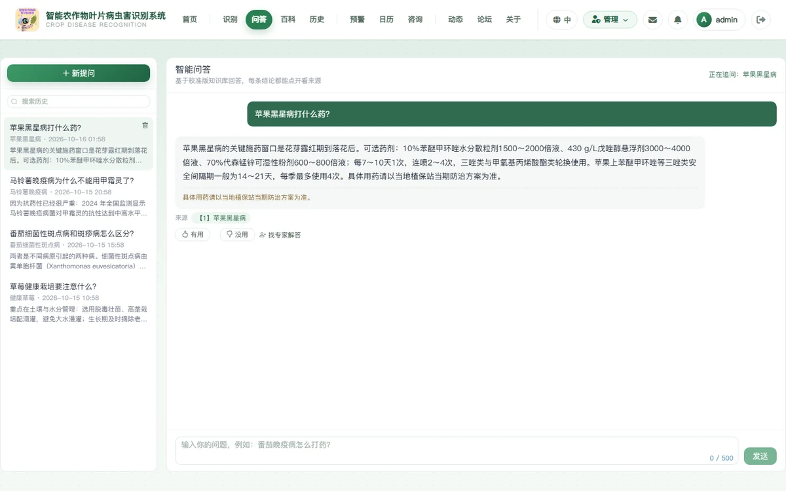
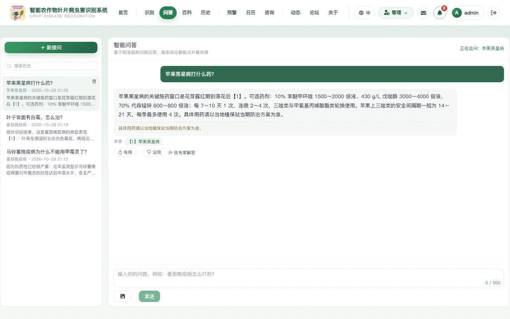
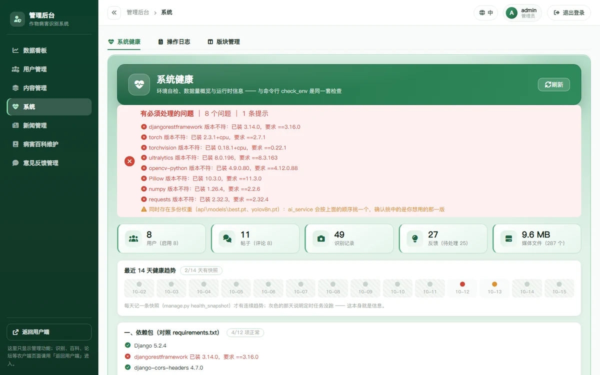
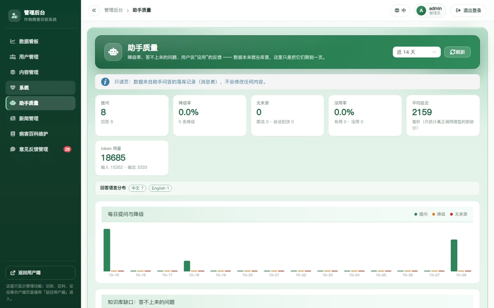

# 智能农作物叶片病虫害识别系统

上传一张叶片照片，得到**病害名称、置信度与防治建议**；配套病害百科、识别历史、病害预警、
种植日历、智能问答、专家咨询与论坛交流，并带一套完整的**管理后台**（用户与权限、内容管理、
新闻、病害百科、意见反馈、操作日志）。

> 面向农户的桌面端 + 移动端两个独立前端，共用一个 Django REST 后端；
> 识别用 YOLOv8 目标检测，**识别结果仅供参考**。


---

## 功能全景

### 农户端（桌面端 Vue 3 / 移动端 Vue 3 + Vant）

| 模块 | 能力 |
|---|---|
| **病虫害识别** | 上传/拍照识别，返回病害名、置信度与标注框；可先选作物减少跨作物误判；一键下载报告 |
| **智能问答** | 只依据站内知识库作答，每条结论带来源编号；站内查不到就明说，不编造；**可上传一张叶片照片**（本地 YOLO 识别当"锚点"，图片不落盘） |
| **识别历史** | 记录列表与详情、按病害筛选、清空 |
| **病害百科** | 38 类词条（26 种病害 + 12 种"健康"）、症状与防治方法、溯源来源、**每页 6 条 3×2 网格**、中英双语 |
| **病害预警** | 当期高发病害（站内识别趋势 + 多用户检出 + 同月历史），未登录也能看 |
| **种植日历** | 农事任务按月查看（14 种作物、每月 9 条以上）；另有"识别记录分布"网格，看出哪几天问题集中 |
| **专家咨询** | 提问（可附图）与作答、专家身份展示、采纳答案 |
| **论坛交流** | 版块、发帖（富文本 + 图片）、评论与回复、点赞收藏、我的草稿、**置顶/加精** |
| **其他** | 私信、通知中心、意见反馈、个人资料、举报、中英文切换 |

### 管理后台（按能力与模块细分，不是"管理员全开"）

> 侧栏按模块合并组织：「内容管理」含帖子 / 评论 / 举报三个页签，识别记录归入「用户管理」，
> 版块管理归入「系统」。下表按**页签能力**列；逐条接口矩阵见
> [`docs/角色与权限矩阵.md`](docs/角色与权限矩阵.md)（由 `role_matrix.py` 自动生成）。

| 页面 / 页签 | 主要能力 | 谁能进 |
|---|---|---|
| 数据看板 | 用户/内容/识别量聚合（用户明细只给全权管理员） | `CONTENT` |
| 用户管理 | 停用·恢复、角色与内容模块授权、开通编辑员、签发重置链接、注销冷静期账号查看 | `USER_ADMIN` |
| 内容管理 · 帖子 | 待审队列、跨帖子管理（筛选/通过·驳回/置顶·加精/批量操作）、**已删除筛选**（追溯删帖）、敏感词库 | `review` 或 `forum`（敏感词另需 `BROADCAST`）|
| 内容管理 · 评论 | 跨帖子评论管理、软删除（**可恢复原文**）、彻底删除 | 同上（彻底删除仅全权管理员）|
| 内容管理 · 举报 | 举报列表与处置；**举报人身份与「同时隐藏内容」仅全权管理员** | `review` 或 `forum` |
| 用户管理 · 识别记录 | 跨用户识别记录（带用户身份与上传图片） | `USER_ADMIN` |
| 系统 · 操作日志 | **23 类**管理动作的审计记录：按动作/时间/关键字筛选，只读 | **仅全权管理员** |
| 系统 · 系统健康 | 环境自检（依赖/迁移/模型文件/目录可写/注销到期/**备份新鲜度**/生产开关）+ 数据量概览 + 运行时信息 + **14 天趋势**（数据来自每天跑一次的 `health_snapshot`，没跑的那天画灰格） | **仅全权管理员** |
| 系统 · 助手质量 | 降级率 / 无来源 Top 榜（= 知识库缺口清单）/ 用户说"没用"的反馈 / token 用量与平均延迟 / 引用最多的词条 | **仅全权管理员** |
| 系统 · 版块管理 | 版块新建·编辑·启停·排序 | `BROADCAST` |
| 新闻管理 | 行业动态增删改、上下架、图片上传 | `news` 模块 |
| 病害百科维护 | 词条增删改、批量导入、农事任务 | `pests` 模块 |
| 意见反馈管理 | 查看/回复/流转状态、批量操作 | `feedback` 模块 |

---

## 界面

<table>
  <tr>
    <td width="50%"><b>识别首页</b><br/></td>
    <td width="50%"><b>论坛交流（含置顶/精华）</b><br/></td>
  </tr>
  <tr>
    <td width="50%"><b>识别结果（真实推理）</b><br/></td>
    <td width="50%"><b>病害百科</b><br/></td>
  </tr>
  <tr>
    <td colspan="2"><b>智能问答 —— 只依据校准版知识库作答，每条结论都能点开看来源；<br/>
      也可以<b>直接上传一张叶片照片</b>（本地识别当"锚点"，图不落盘）</b>
      <br/></td>
  </tr>
  <tr>
    <td colspan="2"><b>智能问答 · 回答与来源（正文里的【1】可点开对应词条）</b>
      <br/></td>
  </tr>
  <tr>
    <td width="50%"><b>管理后台 · 数据看板</b><br/></td>
    <td width="50%"><b>管理后台 · 内容管理（帖子 / 评论 / 举报三个页签）</b><br/></td>
  </tr>
  <tr>
    <td width="50%"><b>管理后台 · 系统（健康 / 操作日志 / 版块管理）</b><br/></td>
    <td width="50%"><b>操作日志（审计，只读）</b><br/></td>
  </tr>
  <tr>
    <td colspan="2"><b>管理后台 · 助手质量（降级率 / 答不上来的问题 / 用户说"没用"的反馈 / token 与延迟）</b>
      <br/></td>
  </tr>
</table>

> 管理端还有一张「评论删除可恢复」留证：`docs/images/admin-comment-restore.webp`
> —— 软删除的评论会保留原文，管理员可在「内容管理 · 评论」里按需恢复。
>
> 截图由 `frontend/scripts/capture-docs-shots.mjs` 用**真实管理员账号 `admin`**
> 自动重截（演示数据跑完即清），再用 `docs/tools/optimize_readme_images.py`
> 缩放并转成 WebP 入库 —— **改了界面结构后请重跑这两个脚本**，别让 README 挂着过期截图
> （第 189 批就是因为没重跑，图上还是早就合并掉的六个侧栏入口）。

---

## 技术栈与结构

```
backend/    Django 5.2 + DRF（SQLite，YOLOv8 推理；112 个 .py + 59 个迁移，约 3.7 万行；含 gunicorn.conf.py / Dockerfile）
frontend/   桌面端 Vue 3 + Element Plus + Vite（:5173；70 个 .vue，约 4.4 万行）
mobile/     移动端 Vue 3 + Vant + Vite（:5174，独立应用，与桌面端零代码共享）
mobile-uni/ 移动端 uni-app 版（:5175，第 232 批起步：H5 已跑通登录/识别/结果，
            同一套代码后续出微信小程序与 Android/iOS APP；暂不动上面那个 Vant H5）
docs/       设计与运维文档、README 配图、工具脚本
tools/      开发辅助脚本（注释覆盖审计等）
deploy/     deploy/nginx.conf（反代示例）；容器编排见根目录 docker-compose.yml
```

识别链路：`图片 → Django 接收 → YOLOv8 推理（backend/api/newmodels/best.pt，39 类）→ 标注图 + 病害映射 → 结构化结果`
（结果与上传文件都落库，供历史与报告使用）。

> ⚠️ 模型输出的类名与系统词条的对应关系，用 `python manage.py check_model_labels` 一次核对：
> 权重类名 vs 手写类名表、每个类能否查到词条、库里有但模型不会输出的僵尸词条。

---

## 快速开始

```bash
# ── 后端（需要一个装好依赖的 Python 环境）──────────────────────────────────

cd backend
pip install -r requirements.txt
python manage.py migrate
python manage.py check_env                    # 环境自检：依赖/数据库/迁移/模型文件
python manage.py init_forum_boards            # 初始化论坛版块（首次跑）
python manage.py runserver 127.0.0.1:8000

# ── 桌面端 ────────────────────────────────────────────────────────────────

cd frontend && npm install && npm run dev      # http://127.0.0.1:5173

# ── 移动端（可选，独立应用）───────────────────────────────────────────────

cd mobile && npm install && npm run dev        # http://127.0.0.1:5174

# ── 移动端 uni-app 版（可选，第 232 批：先跑 H5，后续出小程序/APP）────────

cd mobile-uni && npm install && npm run dev:h5  # http://127.0.0.1:5175
```

> 移动端上线前请按 [`docs/移动端真机自测清单.md`](docs/移动端真机自测清单.md) 在**真手机**上过一遍
> （地址栏伸缩、系统返回键、相机权限、微信内置浏览器、弱网这些自动化测不出来）；
> 工程细节与端口/登录态约定见 [`mobile/README.md`](mobile/README.md)。

> ⚠️ **首次跑之前请先看 [`docs/部署与运维.md`](docs/部署与运维.md)** ——
> 生产环境要装两份依赖：`pip install -r requirements.txt -r requirements-prod.txt`
> （glibc 版 gunicorn / WhiteNoise 等在 `-prod` 里；`requirements.txt` 只保证"开发环境能跑"），
> 另有 `requirements-dev.txt` 放开发辅助工具。文档里还有生产启动、环境变量与必须挂的定时任务。
> 演示数据可用 `add_sample_news` / `add_popular_pests` / `add_detailed_pests` 等管理命令灌入
> （共 **25 个**管理命令，`python manage.py help` 可查）。

> 🔧 **本项目约定的开发环境是一个 conda 环境**（`crop_env`，Python 3.11；`requirements.txt`
> 与它逐项一致，`python manage.py check_env` 会先打印**解释器路径**）。
> 如果仓库里还有 `backend/venv/`，那是某次本地临时建、**不随仓库同步**的旧环境 ——
> 用它启动会看到「系统健康」一片红（7 项「依赖版本不符」，其实只是环境不对，
> 不需要去升级 torch 之类的包）。
>
> 🔧 编辑帖子页顶部那块「开发信息」面板**默认不显示**；要排查问题时用
> `.env.development` 里的 `VITE_SHOW_DEBUG_PANEL=true`，或控制台
> `localStorage.setItem('dsh_debug_panel','1')` 后刷新（见 `frontend/src/utils/debugFlags.js`）。

---

## 测试与验证

```bash
# 后端：910 条测试（权限矩阵、限流、注销冷静期、备份恢复、审计日志、助手多轮/看图/看板……）

cd backend && python manage.py test api.tests

# 桌面端：131 条单元测试 + 类型检查 + 4 个一致性检查脚本（共 6 条检查）

cd frontend && npm run test:unit && npm run type-check && npm run check

# 端到端（真实后端 + 真实浏览器）：7 个 Playwright spec + 43 个按批留证的验证脚本

cd frontend && npm run e2e                     # Playwright 用例（7 个 spec）
cd frontend && node scripts/verify-forum-module.mjs   # 按批留证的验证脚本（43 个）
```

`npm run check` 串了 **4 个脚本、共 6 条检查**（一致性脚本内部再细分 0/A/B 三小项），
都是**踩过坑之后加的**：英文语言包不能残留中文、语言包不许有重复键、中英术语必须一致、
模板用到的 Element Plus 组件必须已注册、**每条路由都要有 `docTitle` 文案**
（它按路由名动态查的，缺了只在控制台留一句警告）。

仓库级自检（提交前跑）：

```bash
python docs/tools/check_line_endings.py        # 行尾一律 LF
python docs/tools/strip_bom.py --check backend/api frontend/src docs
python docs/tools/check_md_links.py            # .md 里的相对链接/图片都存在且**已入库**
python docs/tools/check_i18n_coverage.py       # 模板里还有多少裸露中文（当前 0 条）
python docs/tools/refresh_audit_report.py --check  # 注释审计报告的数字是否需要刷新

# 环境自检（命令行版；管理端「系统健康」页与它是**同一套检查**）

cd backend && python manage.py check_env

# 模型类名 ↔ 词条一致性（"识别对了但显示错了"先跑这个）

cd backend && python manage.py check_model_labels
```

提交完成后的两件事（**不要**混进上面的"提交前自检"，它们的副作用不一样）：

```bash
# 推送并**核对远端 ref**（不是看命令有没有报错）—— 约定见 docs/提交与仓库约定.md

python docs/tools/push_and_verify.py

# 备份到底可不可信：真跑一次演练（造标记物 → 备份 → 破坏 → 恢复 → 逐项核对）

# ⚠️ 它会**改写数据库**，只在副本/预发上跑，不要对着开发库跑

cd backend && python manage.py backup_drill --yes
```

---

## 权限模型（改权限相关代码前必读）

**3 档能力 + 1 个全权标记 × 5 个内容模块**，前后端同一口径
（`backend/api/capabilities.py` 是判定入口，表在 `backend/api/role_matrix.py`）：

| 能力 / 标记 | 含义 | 典型入口 |
|---|---|---|
| `CONTENT` | 内容生产 | 数据看板、内容管理（帖子/评论/举报） |
| `USER_ADMIN` | 用户管理 | 用户管理页、识别记录 |
| `BROADCAST` | 面向全体的发声 | 版块管理、敏感词、公告、预警推送 |
| **`FULL_ADMIN`** | 不可逆动作与敏感读 | 硬删除、批量删除、操作日志、系统健康 |

| 内容模块 | 管什么 |
|---|---|
| `review` 内容审核 | 待审队列、帖子与评论、举报处置（能看能处理，但举报人身份仅全权管理员）（宽口径：**也能管论坛**）|
| `forum` 论坛交流 | 帖子与评论（含审帖、置顶加精、删评论）、已删除帖子追溯、举报处置（同上）|
| `news` 新闻管理 | 行业动态 |
| `pests` 病害百科 | 词条 + 批量导入 + 农事任务 |
| `feedback` 意见反馈 | 反馈查看与回复 |

> 口径原则：**可逆的审核动作给内容编辑员，不可逆的破坏动作只给全权管理员**。
> 第 189 批的举报就是这条原则的典型：编辑员**能**看别人的举报、能处置（改状态 + 备注），
> 但**看不到举报人是谁**（回包匿名化），也**不能**「同时隐藏内容」（不可逆，仅全权管理员；
> 传了不生效，且会明确告知）。三层判定在 `views_report.py` 的
> `_can_handle_reports()` / `_can_see_reporter()`，前端页签与看板待办用同一口径。
> 编辑员由全权管理员在「用户管理 → 新增编辑员」里开通，勾选模块即可。

**逐条接口矩阵**（哪个接口、什么方法、允许哪档能力）见
[`docs/角色与权限矩阵.md`](docs/角色与权限矩阵.md) —— 那份文件**由脚本生成**，
不要手改；跑 `python manage.py role_matrix <用户名>` 可以看某个账号此刻到底能干什么。

---

## 几件在这个项目里"必须知道"的事

这些都不是常规 Django/Vue 常识，而是这个项目特有的、踩过坑的约定。
**改动相关代码前请先读对应说明**：

| 事项 | 说明 |
|---|---|
| **前端有两个登录态存储** | 桌面端用 `sessionStorage`（`auth_token`），移动端用 `localStorage`（`mobile_token`）。写错地方会表现成"看起来已登录、接口全 401"。 |
| **登录会按设备轮换 Token** | 第 231 批起「**每设备一张**」：手机与桌面可以同时在线，登录只让**同设备**的旧 token 失效；改密码 / 被停用 / 注销会吊销**所有设备**。写端到端脚本时仍别用同一个浏览器上下文重新登录（旧 token 会失效）。 |
| **`is_active=False` 的账号登不进来** | 因为 Django 的 `ModelBackend` 直接拒绝 —— 所以**注销冷静期/停用的判断必须放在 `authenticate()` 之前**（见 `views_user.LoginView`）。 |
| **软删除未必可恢复** | 评论从第 152 批起可恢复（留 `original_content` + `deleted_by`）；**帖子刻意不留原文**（`Post.soft_delete` 的注释写了理由），但删帖会写一条审计日志。 |
| **管理动作要写审计日志** | 新增管理端写操作时调用 `api/audit.py: log_admin_action(...)`（23 个动作已接入；`detail` 里**绝不放凭证**，重置链接的 token 只记"已签发"）。作者自删帖子也要留痕。 |
| **点赞/评论计数只由模型层维护** | `models_forum.Like.save/delete` 会精确重算；视图**不要**再 `F()+1`（第 106 批修过一个"多算 1"的 bug）。 |
| **密码策略只有一个来源** | `api/password_policy.py`（8 位 + 禁纯数字 + 弱口令库）。注册/重置/改密三处都调它；**登录不做长度校验**（否则旧密码短的存量用户会被锁在门外）。 |
| **匿名密码校验端点必须限流** | 允许匿名的"用户名+密码"端点（如取消注销申请）挂了 `ScopedRateThrottle` —— 别把限流删掉。 |
| **必须有定时任务** | 备份、完整性校验、**健康快照**、media 清理、注销到期执行 —— **五件事**缺哪件都是"安静的故障"，清单见 `docs/部署与运维.md`。 |
| **改后端代码要重启** | 开发用的是 `runserver --noreload`，改了 `.py` 与 `urls.py` **不重启就不生效**（这个坑踩过三次）。 |
| **`.gitattributes` 固定了行尾** | 仓库里一律 LF。曾经因为 `\r` 让验证脚本误判过好几次；Python 侧写文件要显式 `newline='\n'`，**Django 生成的迁移在 Windows 下默认是 CRLF**，提交前跑行尾自检。 |
| **管理端页面按模块隔离** | 路由 `meta.capability` / `meta.modules`（任一命中）决定能不能进，侧栏同步过滤；**后端接口才是真正的门禁**，前端只是别让人白开一个空页面。 |
| **模型类名以权重为准** | 权重里的 `names` 是唯一权威；手写类名表只是兜底。二者错位一位就会"框上写着 A、详情显示 B"，且**全程静默** —— 换模型后先跑 `check_model_labels`。 |

---

## 文档导航（先读哪个）

| 想做的事 | 先读 |
|---|---|
| 部署 / 上线 | [`docs/部署与运维.md`](docs/部署与运维.md) |
| 备份与恢复（**含恢复演练脚本**） | [`docs/备份与恢复.md`](docs/备份与恢复.md) |
| 查某个账号能干什么 / 接口级权限 | [`docs/角色与权限矩阵.md`](docs/角色与权限矩阵.md)（**脚本生成，勿手改**） |
| 了解角色与模块权限怎么设计的 | [`docs/内容编辑角色方案.md`](docs/内容编辑角色方案.md) |
| 智能问答 / 知识库 | [`docs/智能回答助手框架.md`](docs/智能回答助手框架.md)、[`docs/知识库入库方案.md`](docs/知识库入库方案.md)、[`docs/knowledge_base/README.md`](docs/knowledge_base/README.md) |
| 了解"某个功能为什么这样设计" | [`docs/系统完善记录.md`](docs/系统完善记录.md)（**按 200+ 批记录，含每次踩的坑**） |
| 还差哪些功能 | [`docs/功能缺口评估.md`](docs/功能缺口评估.md)（第 35 批快照，文首已标注后来补上了哪些） |
| 提交 / 拆提交 / 推送的约定 | [`docs/提交与仓库约定.md`](docs/提交与仓库约定.md) |
| 管理后台是怎么合并的 | [`docs/后台合并改造路线图.md`](docs/后台合并改造路线图.md) |
| 了解注释覆盖率与方法论 | [`docs/注释覆盖审计报告.md`](docs/注释覆盖审计报告.md) |
| 移动端上线前真机过一遍 | [`docs/移动端真机自测清单.md`](docs/移动端真机自测清单.md) |
| 跑端到端测试 | [`frontend/e2e/README.md`](frontend/e2e/README.md) |
| 环境变量都有哪些 | [`backend/.env.example`](backend/.env.example)（每项都写了取值理由） |

---

## 许可与用途

教学 / 毕业设计用途。病害识别模型的训练数据来自公开的 PlantVillage 数据集（38 个病害类别
+ 1 个"背景/无叶片"类），**识别结果仅供参考**，实际防治请咨询当地植保站。
