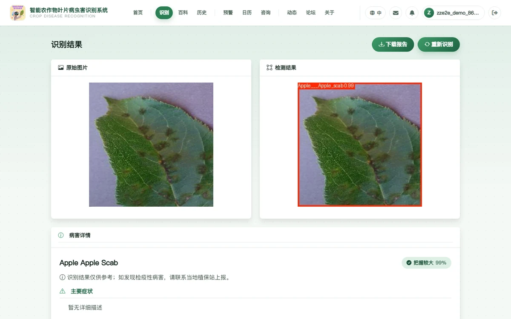
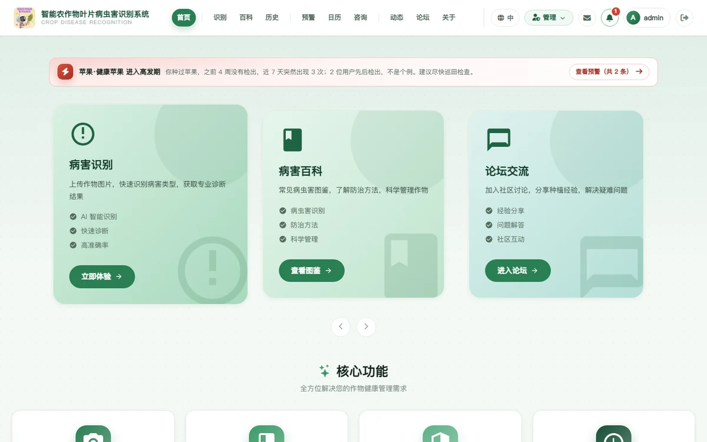
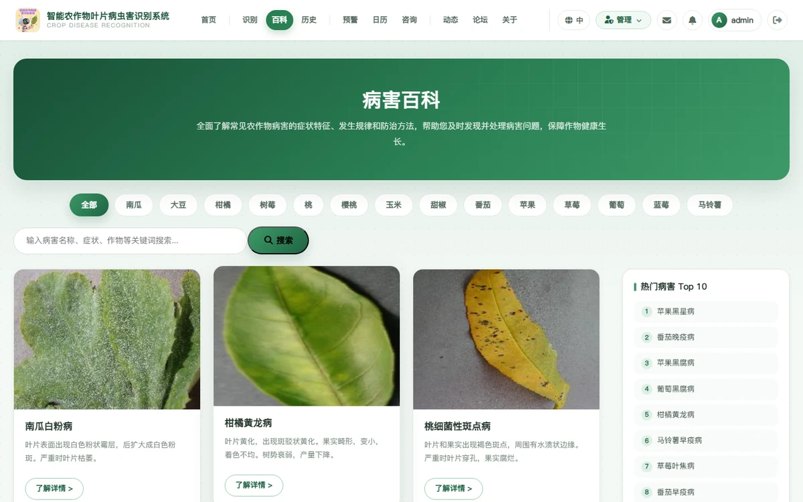
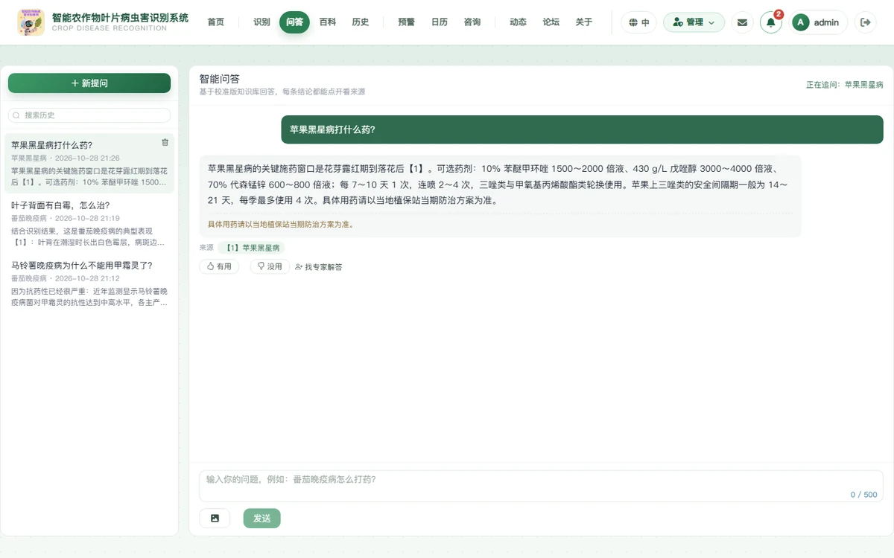
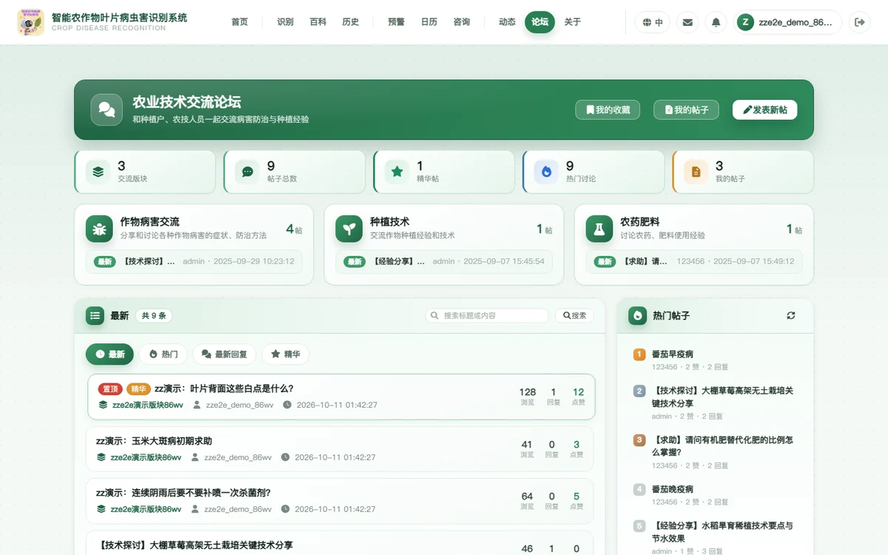
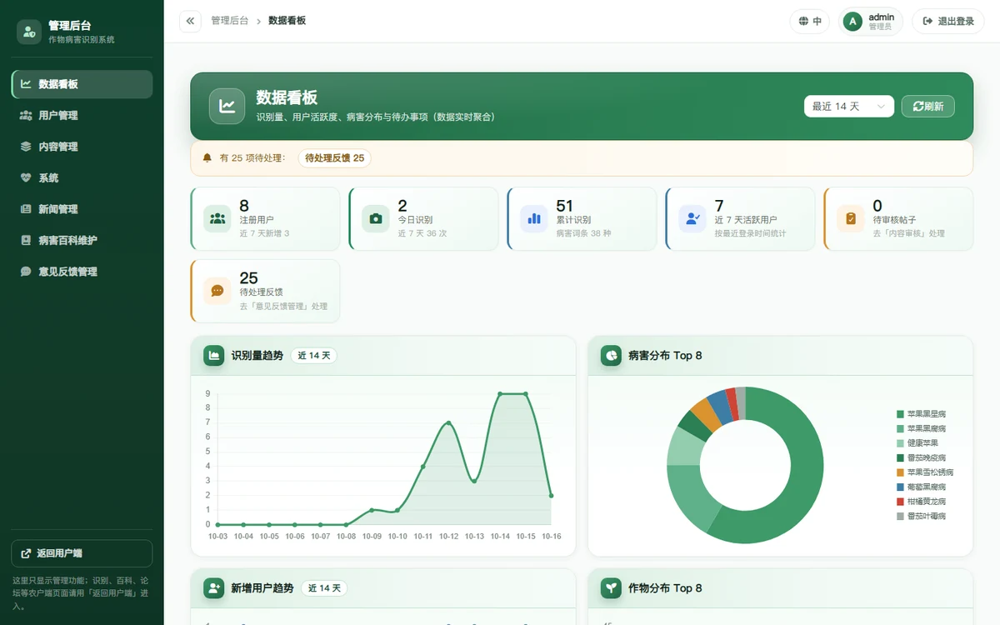
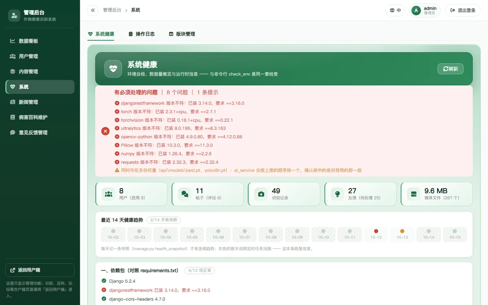
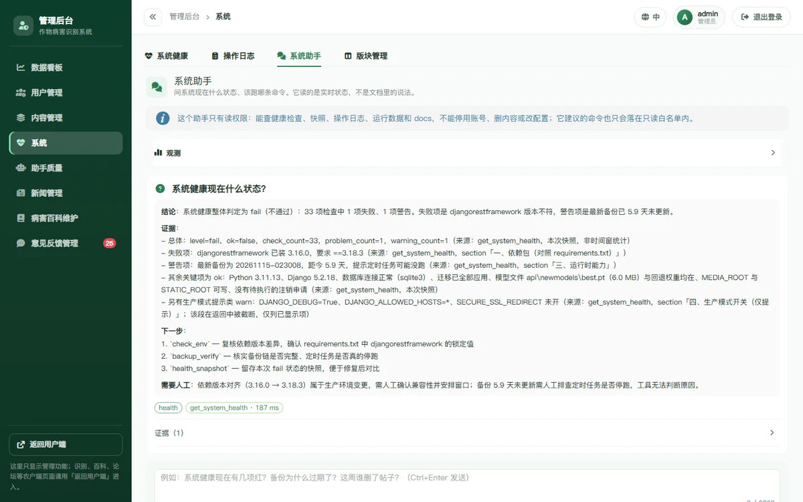
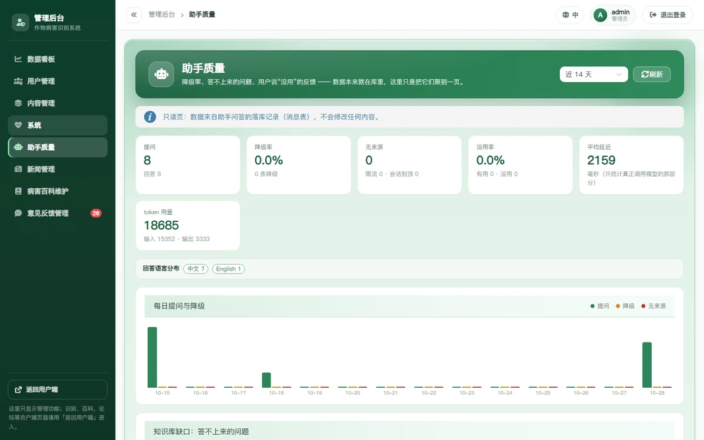

# 智能农作物叶片病虫害识别系统

上传叶片照片，得到**病害名称、置信度与防治建议**；配套病害百科、识别历史、预警、种植日历、
智能问答、专家咨询、论坛，以及完整管理后台。

- **在线体验**：[www.shiguangiliushi.com](https://www.shiguangiliushi.com)（**免登录可试用 3 次识别 / 5 次问答**）
- **训练侧代码**：[crop-disease-training](https://github.com/shiguangiliushi/crop-disease-training)（数据清洗 → 切分 → 训练 → 评估）

| 项 | 值 |
|---|---|
| 识别模型 | **YOLOv8n**（3.02 M 参数），**39 类**（26 病害 + 12 健康 + 1 背景类），权重 **5.97 MB** |
| 离线指标 | P **87.8%** / R **89.6%** / mAP50 **91.5%**（val 全量 4528 张，CPU） |
| 推理速度 | 单张 **131 ms**（CPU，imgsz=640）；站内识别接口预热后 **≈0.8 s/张**，冷启动首张 26 s |
| 技术栈 | Django 5.2 + DRF · Vue 3 + Element Plus · **LangGraph 1.2.24** · Ultralytics 8.3 · Docker Compose |
| 系统助手 | **LangGraph 四节点状态图**，工具读写分离，不可逆写走「待确认表 + 原子认领」 |
| 规模 | 单人完成 · **480 次提交** · 桌面端 + 两套移动端（Vant H5 / uni-app） |

> ⚠️ **指标口径（先说清，别误读）**：这份数据集的标注是**整图单框**（框宽、框高归一化后中位数都为 1.0），
> 所以 mAP50 与 mAP50-95 必然相等 —— **这个 mAP 实质是 39 类分类准确率**，不是田间多目标定位精度；
> 且 val 与 train 同源（含增强副本），**换到真实田间照片会明显下降**。
> 评估方式、复现命令与"为什么只有这个口径"见
> [docs/评估方法.md](https://github.com/shiguangiliushi/crop-disease-training/blob/main/docs/%E8%AF%84%E4%BC%B0%E6%96%B9%E6%B3%95.md)。



## 系统助手（Agent）

管理端有一个**能查状态、也能代办**的助手。它跑在自己的状态图上（LangGraph `StateGraph`），
不是"拼一段 prompt 让模型自由发挥"：

- **四节点 + 条件路由**：`plan` 决定下一步 → `read` 执行只读工具 → `guard` 处理写动作 → `answer` 收口。
  无工具调用直落 `answer`；只读工具回 `plan` 循环；含写动作才进 `guard`
- **双上限**：`MAX_STEPS=4` 卡住"模型反复查"的循环，`MAX_WRITES=1` 保证一轮问答最多一次写
- **工具读写分离**：8 个只读工具（系统健康、14 天趋势、审计摘要、运行数据、纠错样本、识别错例、
  文档检索、只读 `manage.py` 自检）走一个**按名字通用执行**的入口；3 个可逆写工具
  （核实样本 / 标记已处理 / 回复反馈）单独一个注册表，**只能**经 `validate() → execute()` 执行 ——
  写工具若混进只读表，等于给模型开了一条写权限通道
- **不可逆写只提议、不执行**：`delete_feedback` 默认不进模型工具表（`OPS_IRREVERSIBLE_ENABLED=False`），
  开关打开后也只生成一条待确认记录
- **为什么弃用 `interrupt()`**：第 424 批用 LangGraph 的 `interrupt()` 做"提议 → 确认"，
  `InMemorySaver` 的状态在**进程内存**里 —— gunicorn 多 worker 时确认请求会落到另一个进程，
  表现是"点了确认没反应"；进程重启则静默丢失。第 425 批改为落 `OpsPendingWrite` 表：
  图只负责提议，确认是另一个确定性请求，**不经过图、也不经过模型**
- **防双击 / 重放**：确认走 `UPDATE … WHERE status='pending'` **原子认领**，第二个请求只拿到 `consumed`
- **"这算不算确认"是纯函数**，不交给模型 —— 否则模型能确认自己刚提的议
- **模型适配层**：自写 `DjangoLLM(BaseChatModel)`，**刻意不装 openai SDK**，避免它的重试策略
  长出第二套超时口径
- **测试**：`api/tests_agent.py` **45 条**用例，模型替换为 `ScriptedModel`（按脚本吐 `AIMessage`），
  不打真实端点、不花额度

设计取舍见 [`docs/智能回答助手框架.md`](docs/智能回答助手框架.md)。

## 功能

| 端 | 模块 | 能力 |
|---|---|---|
| 农户 | 病虫害识别 | 上传/拍照，返回病害名、置信度、标注框；可先选作物减少误判；下载报告 |
| 农户 | 智能问答 | 只依据站内知识库作答并带来源编号，查不到就明说；可上传叶片照片当"锚点"（图不落盘） |
| 农户 | 识别后追问 | 识别结果页直接问助手，回答锚定该病害并给出来源 |
| 农户 | 病害百科 | 38 类词条（26 病害 + 12 健康）、症状与防治、溯源来源、中英双语 |
| 农户 | 预警 / 日历 | 当期高发病害（未登录可看）；农事任务按月 + 识别记录分布 |
| 农户 | 社区 | 专家咨询、论坛（发帖/评论/点赞收藏/草稿/置顶加精）、私信、通知、举报 |
| 游客 | **免登录试用** | 不注册即可识别 3 次、提问 5 次（按 IP 计，次日 0 点重置）；额度在服务端按 `UPDATE … WHERE < 上限` 原子扣减，用尽返回 402 并引导注册；只能读全站内容，发帖/反馈/私信一律 403 |
| 管理 | 内容 | 帖子 / 评论 / 举报三个页签（含已删除追溯、敏感词库） |
| 管理 | 用户 | 停用·恢复、角色与模块授权、开通编辑员、签发重置链接、注销冷静期 |
| 管理 | 百科 / 新闻 / 反馈 | 词条增删改与批量导入、行业动态、意见反馈流转 |
| 管理 | 系统 | 操作日志（28 类动作，只读）、系统健康（环境自检 + 14 天趋势）、系统助手（问状态 / 代执行**可逆**操作）、助手质量看板、版块管理 |

权限：**3 档能力**（`CONTENT` / `USER_ADMIN` / `BROADCAST`）+ **全权标记**（`FULL_ADMIN`）
× **5 个内容模块**（`review` / `forum` / `news` / `pests` / `feedback`）。
原则：**可逆的审核动作给编辑员，不可逆动作只给全权管理员**。
接口级矩阵见 [`docs/角色与权限矩阵.md`](docs/角色与权限矩阵.md)（脚本生成，勿手改）。

## 界面

| | |
|---|---|
|  |  |
|  |  |
|  |  |
|  |  |

> 截图由 `frontend/scripts/capture-docs-shots.mjs` 重截、`docs/tools/optimize_readme_images.py`
> 转 WebP；**改界面后请重跑这两个脚本**（第 189 批因漏跑，图上还是已合并掉的侧栏入口）。
> 只想补某一张时用 `node scripts/capture-docs-shots.mjs --only <文件名>`（第 420 批加）——
> 全量重跑会把十几张都重拍，工作区里若有别人未提交的界面改动，会被一起拍进入库的图。

## 技术栈与结构

```
backend/    Django 5.2 + DRF（SQLite、YOLOv8n；含 gunicorn.conf.py / Dockerfile）
frontend/   桌面端 Vue 3 + Element Plus + Vite   :5173
mobile/     移动端 Vue 3 + Vant + Vite           :5174（独立应用）
mobile-uni/ 移动端 uni-app（H5 :5175，后续出小程序/APP）
docs/       设计与运维文档、README 配图、工具脚本；tools/ 开发辅助；deploy/ 反代示例
```

识别链路：`图片 → Django → YOLOv8n（backend/api/newmodels/best.pt，5.97 MB，39 类）→ 标注图 + 词条映射 → 结构化结果`。

> 换模型后先跑 `python manage.py check_model_labels`：**权重里的类名是唯一权威**，
> 与词条错位会"框上 A、详情 B"且全程静默。

> **模型训练代码**单独放在 [shiguangiliushi/crop-disease-training](https://github.com/shiguangiliushi/crop-disease-training)：
> 标签清洗 → 数据集切分 → 训练（Ultralytics 8.3.143）。
> 线上这份权重是 **YOLOv8n 从 COCO 预训练微调**得来（checkpoint 内 `train_args`：imgsz 640 / batch 16 /
> 50 轮 / AMP / GPU，Ultralytics 8.3.168），**不是**那个仓库里 `yolov11.yaml` 的 CPU 跑法 ——
> 后者只用来验证流水线，39 类在 CPU 上不收敛。两边的区别见该仓库 README 开头的说明。
> 线上权重实测 **P 87.8% / R 89.6% / mAP50 91.5%**（39 类，val 4528 张，CPU）；
> 评估方式、以及"这份数据的检测其实是整图单框分类"这一关键前提，见该仓库的 `docs/评估方法.md`。

## 快速开始

```bash
cd backend && pip install -r requirements.txt && python manage.py migrate
python manage.py check_env && python manage.py init_forum_boards   # 自检 + 首次初始化
python manage.py runserver 127.0.0.1:8000

cd frontend   && npm install && npm run dev        # :5173
cd mobile     && npm install && npm run dev        # :5174
cd mobile-uni && npm install && npm run dev:h5     # :5175
```
- 开发环境约定为 conda `crop_env`（Python 3.11）；生产依赖另装 `requirements-prod.txt`，
  启动与环境变量见 [`docs/部署与运维.md`](docs/部署与运维.md)。
- 移动端上线前按 [`docs/移动端真机自测清单.md`](docs/移动端真机自测清单.md) 在真机过一遍。
- 演示数据：`add_sample_news` / `add_popular_pests` / `add_detailed_pests` 等（`manage.py help` 查全部）。

## 测试

```bash
cd backend  && python manage.py test api.tests        # 后端
cd frontend && npm run test:unit && npm run type-check && npm run check   # 桌面端
cd frontend && npm run e2e                            # Playwright（真实后端 + 浏览器）
python docs/tools/check_line_endings.py               # 行尾 LF
python docs/tools/check_md_links.py                   # 文档链接/图片存在且已入库
python docs/tools/check_i18n_coverage.py              # 模板裸露中文（当前 0 条）
python docs/tools/push_and_verify.py                  # 推送后核对远端 ref
```

`npm run check` 含 6 条一致性检查（中英语言包、重复键、术语一致、Element Plus 注册、路由 docTitle）。

## 必须知道的约定

| 事项 | 说明 |
|---|---|
| 两个登录态 | 桌面 `sessionStorage.auth_token`、移动端 `localStorage.mobile_token`；写错地方会"看起来已登录、接口全 401" |
| 按设备轮换 Token | 手机与桌面可同时在线；改密码 / 停用 / 注销会吊销所有设备 |
| `is_active=False` 登录 | 被 `ModelBackend` 直接拒绝 → 停用/冷静期判断必须在 `authenticate()` **之前** |
| 软删除 | 评论可恢复（留原文）；帖子刻意不留，但删帖写审计日志 |
| 审计日志 | 管理端写操作调 `api/audit.py: log_admin_action(...)`；`detail` 绝不放凭证 |
| 计数 | 点赞/评论计数只由模型层维护，视图不要再 `F()+1` |
| 密码策略 | 唯一来源 `api/password_policy.py`；登录不做长度校验 |
| 匿名密码端点 | 必须挂 `ScopedRateThrottle`，别删限流 |
| 定时任务 | 备份 / 完整性校验 / 健康快照 / media 清理 / 注销到期，五件事缺一件都是"安静的故障" |
| 改 .py 要重启 | 开发用 `runserver --noreload` |
| `ModuleNotFoundError: drf_spectacular` | 用的是 **base** 环境。依赖装在 `crop_env`（见上面「运行」）；先 `conda activate crop_env`，别往 base 里装 |
| 行尾 | 全仓库 LF；Django 迁移在 Windows 下是 CRLF，提交前跑行尾自检 |

## 文档导航

| 想做的事 | 先读 |
|---|---|
| 部署 / 备份 | [`docs/部署与运维.md`](docs/部署与运维.md)、[`docs/备份与恢复.md`](docs/备份与恢复.md) |
| 权限与角色设计 | [`docs/角色与权限矩阵.md`](docs/角色与权限矩阵.md)、[`docs/内容编辑角色方案.md`](docs/内容编辑角色方案.md) |
| 智能问答 / 知识库 | [`docs/智能回答助手框架.md`](docs/智能回答助手框架.md)、[`docs/知识库入库方案.md`](docs/知识库入库方案.md) |
| 为什么这样设计 | [`docs/系统完善记录.md`](docs/系统完善记录.md)（按批记录，含索引） |
| 训练侧（独立仓库） | [shiguangiliushi/crop-disease-training](https://github.com/shiguangiliushi/crop-disease-training)：数据清洗 → 切分 → 训练 → 评估；拆分与推送过程见 `docs/系统完善记录.md` |
| 还差哪些功能 | [`docs/功能取舍.md`](docs/功能取舍.md)（现行结论：做什么 / 有条件做 / 不做；含"被核对推翻的 5 条"） |
| 提交与推送约定 | [`docs/提交与仓库约定.md`](docs/提交与仓库约定.md) |
| 端到端测试 | [`frontend/e2e/README.md`](frontend/e2e/README.md) |
| 环境变量 | [`backend/.env.example`](backend/.env.example)、生产模板 [`backend/.env.production.example`](backend/.env.production.example) |

## 许可

仅用于学习与研究；识别结果不构成农业防治建议。
