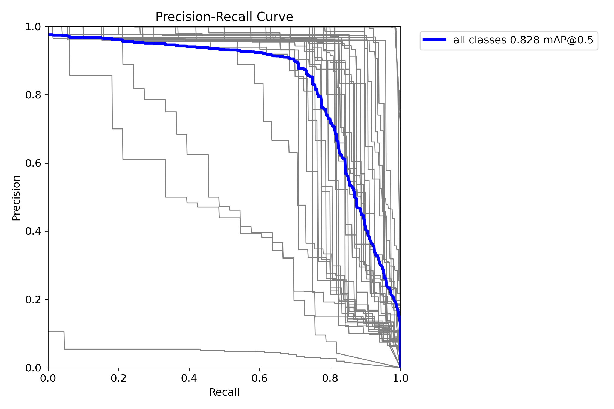
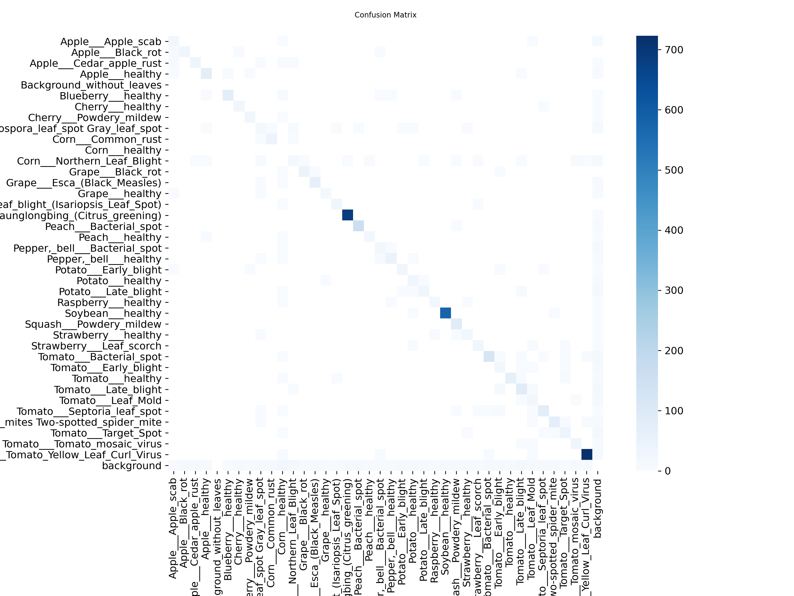
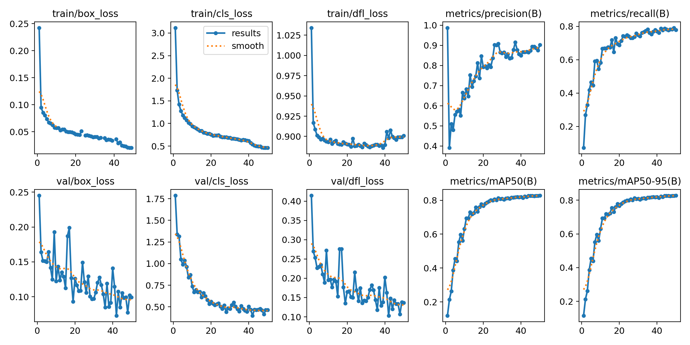

# 植物叶片疾病检测 - YOLOv8项目

这是一个使用YOLOv8进行植物叶片疾病检测的项目。项目包含38个不同的植物疾病类别，能够自动识别和分类各种植物叶片疾病。

## 数据集信息

本项目包含以下38个类别：

### 苹果类

- Apple___Apple_scab (苹果黑星病)
- Apple___Black_rot (苹果黑腐病)
- Apple___Cedar_apple_rust (苹果雪松锈病)
- Apple___healthy (健康苹果)

### 其他水果类

- Blueberry___healthy (健康蓝莓)
- Cherry___healthy (健康樱桃)
- Cherry___Powdery_mildew (樱桃白粉病)
- Grape___Black_rot (葡萄黑腐病)
- Grape___Esca_(Black_Measles) (葡萄黑麻疹病)
- Grape___healthy (健康葡萄)
- Grape___Leaf_blight_(Isariopsis_Leaf_Spot) (葡萄叶枯病)
- Orange___Haunglongbing_(Citrus_greening) (柑橘黄龙病)
- Peach___Bacterial_spot (桃细菌性斑点病)
- Peach___healthy (健康桃)
- Raspberry___healthy (健康树莓)
- Strawberry___healthy (健康草莓)
- Strawberry___Leaf_scorch (草莓叶焦病)

### 蔬菜类

- Corn___Cercospora_leaf_spot Gray_leaf_spot (玉米尾孢叶斑病)
- Corn___Common_rust (玉米普通锈病)
- Corn___healthy (健康玉米)
- Corn___Northern_Leaf_Blight (玉米北方叶枯病)
- Pepper,_bell___Bacterial_spot (甜椒细菌性斑点病)
- Pepper,_bell___healthy (健康甜椒)
- Potato___Early_blight (马铃薯早疫病)
- Potato___healthy (健康马铃薯)
- Potato___Late_blight (马铃薯晚疫病)
- Soybean___healthy (健康大豆)
- Squash___Powdery_mildew (南瓜白粉病)
- Tomato___Bacterial_spot (番茄细菌性斑点病)
- Tomato___Early_blight (番茄早疫病)
- Tomato___healthy (健康番茄)
- Tomato___Late_blight (番茄晚疫病)
- Tomato___Leaf_Mold (番茄叶霉病)
- Tomato___Septoria_leaf_spot (番茄斑枯病)
- Tomato___Spider_mites Two-spotted_spider_mite (番茄二斑叶螨)
- Tomato___Target_Spot (番茄靶斑病)
- Tomato___Tomato_mosaic_virus (番茄花叶病毒)
- Tomato___Tomato_Yellow_Leaf_Curl_Virus (番茄黄化曲叶病毒)

### 其他

- Background_without_leaves (无叶片背景)

## 项目结构

```
Plant_leave_diseases_dataset_with_augmentation/
├── dataset/                          # 处理后的数据集
│   ├── images/
│   │   ├── train/                    # 训练图片
│   │   └── val/                      # 验证图片
│   └── labels/
│       ├── train/                    # 训练标注文件
│       └── val/                      # 验证标注文件
├── runs/                             # 训练结果
│   └── train/
│       └── plant_disease_detection/
│           └── weights/
│               ├── best.pt           # 最佳模型
│               └── last.pt           # 最新模型
├── prepare_dataset.py                # 数据集预处理脚本
├── train_yolov8.py                   # 训练脚本
├── predict.py                        # 预测脚本
├── dataset.yaml                      # 数据集配置文件
├── requirements.txt                  # 依赖包列表
└── README.md                         # 项目说明
```

## 安装依赖

```bash
pip install -r requirements.txt
```

## 使用步骤

### 1. 数据预处理

首先运行数据预处理脚本，将原始图片转换为YOLOv8格式：

```bash
python prepare_dataset.py
```

这个脚本会：
- 创建YOLO格式的数据集目录结构
- 为每张图片创建对应的标注文件
- 将数据集分割为训练集和验证集
- 显示每个类别的统计信息

### 2. 训练模型

运行训练脚本：

```bash
python train_yolov8.py
```

训练参数说明：
- `epochs`: 训练轮数 (默认100)
- `imgsz`: 输入图片尺寸 (默认640)
- `batch`: 批次大小 (默认16)
- `device`: 训练设备 (自动选择)

### 3. 模型预测

#### 预测单张图片

```bash
python predict.py --image path/to/image.jpg --conf 0.5
```

#### 批量预测

```bash
python predict.py --dir path/to/images/ --output results/ --conf 0.5
```

参数说明：
- `--model`: 模型路径 (默认使用最佳模型)
- `--image`: 单张图片路径
- `--dir`: 图片目录路径
- `--output`: 输出目录
- `--conf`: 置信度阈值 (默认0.5)

## 训练配置

主要训练参数在 `train_yolov8.py` 中配置：

- **学习率**: 初始0.01，最终0.01
- **优化器**: 自动选择
- **数据增强**: 启用mosaic、mixup等
- **早停**: patience=20，20个epoch无改善则停止
- **保存**: 每10个epoch保存一次

## 模型性能

在Google Colab GPU上训练约50个epoch（patience=20早停），最终在验证集（24,595张图）上的指标：

| 指标 | 数值 |
| --- | --- |
| **mAP@0.5** | **0.828** |
| Precision | 约0.89 |
| Recall | 约0.78 |
| 模型权重 | YOLOv8n，约6.2MB |

训练配置：imgsz=640，batch=16，AMP混合精度开启，close_mosaic=10，数据增强含HSV色域扰动、Mosaic、随机翻转、随机擦除。

训练完成后，可以在以下位置查看结果：
- 模型权重: `runs/train/weights/best.pt`
- 训练曲线、混淆矩阵、PR曲线: `runs/train/` 目录下的 png 文件

### 训练可视化

**PR 曲线（all classes mAP@0.5 = 0.828）：**



**混淆矩阵：**



**训练曲线（loss / precision / recall / mAP）：**



## 注意事项

1. **硬件要求**: 建议使用GPU训练（Google Colab T4 即可），CPU 训练会非常慢
2. **数据集大小**: 共 122,972 张图片（训练集 98,377 / 验证集 24,595）
3. **训练时间**: Colab T4 GPU 上约 1–2 小时（50 epoch）
4. **内存使用**: 建议至少 16GB 系统内存

## 故障排除

### 常见问题

1. **CUDA内存不足**
   - 减小batch size
   - 减小图片尺寸
   - 使用更小的模型 (yolov8n)

2. **数据集加载错误**
   - 检查图片格式是否支持
   - 确保标注文件格式正确
   - 验证dataset.yaml配置

3. **训练不收敛**
   - 调整学习率
   - 检查数据质量
   - 增加训练轮数

## 许可证

本项目仅供学习和研究使用。

## 贡献

欢迎提交Issue和Pull Request来改进项目。
